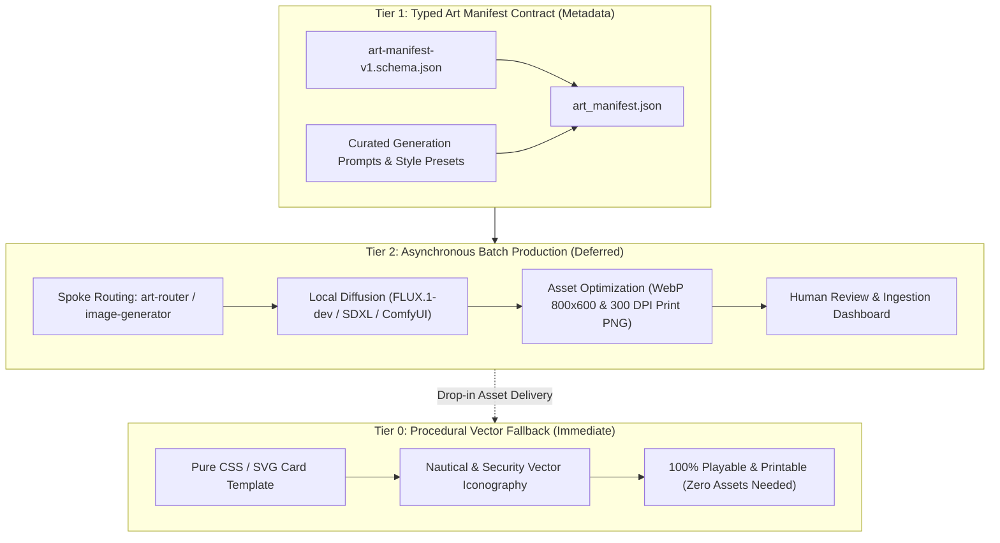

# Krabs Against Security: Art Deferral Pipeline Architecture

## 1. Context & Motivation

Card games typically require 60 to 100 individual high-quality illustrations, distinct card backings, and specialized iconography. Tying game engine development, rules balancing, and print layout to completed visual artwork introduces critical project stalls.

To eliminate this dependency, **Krabs Against Security (K.A.S.)** establishes a **3-Tier Art Deferral Architecture**. The game rules, web simulator, and print-and-play generators remain 100% playable and deployable from Day 1 without requiring a single raster illustration, while providing an automated, typed ingestion pathway for assets as they are generated.

---

## 2. The 3-Tier Art Architecture



### 2.1 Tier 0: Procedural Vector Fallback (Zero-Asset Playability)

When an illustration is ungenerated or marked `deferred`, the card renderer executes a procedural SVG/CSS layout:
1. **Thematic Header & Border**: A heavy double-line border color-coded to the card deck (Red, Yellow, Purple, Brown, Blue, Slate) with corner brass rivets.
2. **Procedural Art Box**: Rather than an empty rectangle or broken image placeholder, the art container renders:
   - A soft radial vignette background.
   - An oversized, high-contrast monochrome vector glyph representing the card's action (e.g., an oyster shell with an ethernet cable, a fish hook dangling a phishing email, a glowing green nautical radar, a rusty vault safe).
   - A subtle nautical coordinate watermark (e.g., `LAT 11°58'N LON 165°23'E`).
3. **Typography & Mechanics Box**: High-readability system fonts (maritime slab serif headers + crisp monospace terminal body) displaying the exact game mechanics, d20 check requirements, and flavor text.
4. **Print Compatibility**: The Tier 0 fallback produces crisp, ink-efficient printouts on any consumer printer.

### 2.2 Tier 1: Typed Art Manifest (`art_manifest.json`)

All visual asset requirements are registered in a versioned, machine-readable JSON manifest.

#### Manifest JSON Schema Definition (`art-manifest-v1.schema.json`)
```json
{
  "$schema": "http://json-schema.org/draft-07/schema#",
  "title": "KASArtManifest",
  "type": "object",
  "required": ["version", "style_preset", "cards"],
  "properties": {
    "version": { "type": "string" },
    "style_preset": {
      "type": "object",
      "required": ["name", "base_prompt", "negative_prompt", "aspect_ratio"],
      "properties": {
        "name": { "type": "string" },
        "base_prompt": { "type": "string" },
        "negative_prompt": { "type": "string" },
        "aspect_ratio": { "type": "string" }
      }
    },
    "cards": {
      "type": "array",
      "items": {
        "type": "object",
        "required": ["card_id", "title", "deck", "art_status", "prompt", "asset_path"],
        "properties": {
          "card_id": { "type": "string" },
          "title": { "type": "string" },
          "deck": { "type": "string", "enum": ["initial_compromise", "pivot_escalate", "persistence", "c2_exfil", "procedures", "injects"] },
          "art_status": { "type": "string", "enum": ["deferred", "queued", "generating", "review_needed", "approved", "rejected"] },
          "prompt": { "type": "string" },
          "negative_prompt": { "type": "string" },
          "seed": { "type": "integer" },
          "asset_path": { "type": "string" },
          "print_asset_path": { "type": "string" }
        }
      }
    }
  }
}
```

#### Sample Card Entry in Manifest
```json
{
  "card_id": "IC-001",
  "title": "Spear Phishing with Actual Chum",
  "deck": "initial_compromise",
  "art_status": "deferred",
  "prompt": "Saturday morning cartoon satire meets dark cyberpunk undersea aesthetic. A comically suspicious underwater phishing email displayed on a chunky CRT monitor encrusted with sea barnacles. An email attachment labeled 'free_kelp_recipe.xlsm' has a giant steel fishing hook dangling menacingly out from the glass screen into an undersea office. Rich turquoise ocean water, glowing emerald phosphor terminal text, cel-shaded animation style, dynamic lighting, sharp outlines.",
  "negative_prompt": "blurry, photorealistic human, watermark, low quality, 3d render, deformed",
  "seed": 42077,
  "asset_path": "assets/cards/IC-001.webp",
  "print_asset_path": "assets/cards/print/IC-001-300dpi.png"
}
```

### 2.3 Tier 2: Asynchronous Batch Synthesis & Ingestion

Asset generation runs independently of application releases:
1. **Generation Execution**:
   - **Antigravity Tooling / Subagent**: Delegated to the `image-generator` subagent for targeted single-card generation.
   - **Dedicated Domain Spoke (`art-router`)**: In production or bulk mode, routed to `Koality-Assured/art-router` using the `artistic-production` operator (`harness prompt`, FLUX.1-dev / SDXL pipelines) per workspace routing rules.
2. **Automated Asset Processing Script (`scripts/art/process_card_art.py`)**:
   - Takes raw generated outputs ($1024 \times 1024$ or $1344 \times 768$).
   - Crops and resamples to the card art ratio ($4:3$ / $800 \times 600\text{ px}$).
   - Compresses to modern, high-efficiency WebP format ($<80\text{ KB}$, $85\%$ quality) for fast web client loading.
   - Generates 300 DPI CMYK-compatible uncompressed PNGs for the print sheet generator.
3. **Progressive Web Hydration**:
   - The web client checks for the presence of the WebP asset at `asset_path`.
   - If present and status is `approved`, the card smoothly hydrates with the image.
   - If missing, 404, or still marked `deferred`, the client displays the Tier 0 procedural vector illustration without throwing console errors or layout shifts.

---

## 3. Style Guide & Generative Art Tokens

To maintain visual cohesion across all 80 cards:

- **Art Style Archetype**: *"Nautical Cyberpunk Cartoon Satire"*.
- **Color Palette Tokens**:
  - `Ocean Deep`: Deep navy, abyss blue (`#0a192f`, `#0f3460`).
  - `Bioluminescent Green`: Terminal phosphor, toxic plankton glow (`#00ff9f`, `#39ff14`).
  - `Corrosion & Rust`: Salty iron, weathered bronze, brass rivets (`#cd7f32`, `#d4a373`).
  - `Hazard Red`: Alarms, initial compromise warning glow (`#ff4757`).
- **Compositional Framing**:
  - Centered hero subject with distinct silhouette.
  - Exaggerated proportions (oversized computer plugs, comically tangled undersea cables, comical underwater fauna).
  - High tonal contrast between foreground character/device and undersea background.
