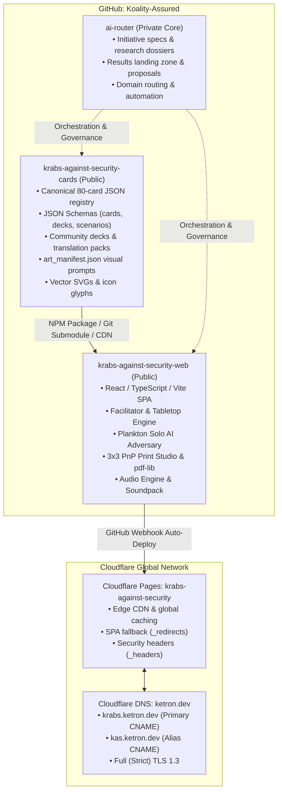
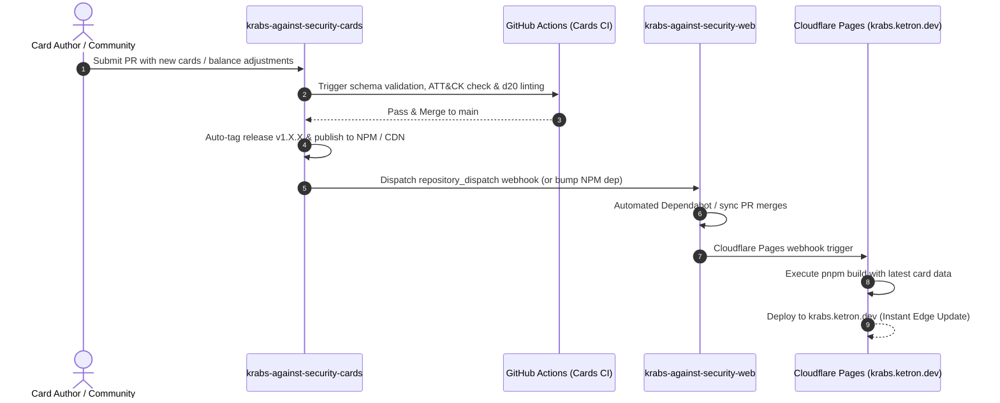

# Krabs Against Security: Repository Topology & Cloudflare Deployment Architecture

## 1. Multi-Repository Topology Overview

To preserve modularity, enable independent content evolution, and foster open-source community contributions, **Krabs Against Security (K.A.S.)** is architected across two distinct, public repositories within the `Koality-Assured` GitHub organization, alongside centralized specification in `ai-router`.



---

## 2. Public Repository Specifications

### 2.1 Web Application Repository: `Koality-Assured/krabs-against-security-web`

- **Purpose**: Host the complete, production-grade web client containing the interactive tabletop game, facilitator companion, Plankton AI adversary engine, and the Print-and-Play (PnP) export studio.
- **Visibility**: **Public** (Open Source, MIT or Apache-2.0 License).
- **Core Technology Stack**:
  - Runtime / Build: Vite, TypeScript (strict mode), Tailwind CSS.
  - UI Architecture: Component-driven reactive client (React / Preact) optimized for zero-overhead static distribution.
  - Card & Board Rendering: Pure semantic CSS/SVG Tier 0 card templates with canvas support for animated table effects.
  - Client-Side PDF Generator: `pdf-lib` for mathematical 300 DPI vector PDF sheet generation.
  - Audio Engine: Web Audio API / Howler.js for procedural nautical and retro incident response soundscapes.
  - Persistence: Browser `localStorage` / `IndexedDB` for local scenario state, custom deck cache, and game progression.
- **Data Ingestion Model**:
  - Consumes card data from `@koality-assured/krabs-against-security-cards` as an npm dependency, git submodule, or dynamically fetches versioned bundles via CDN (`https://cdn.jsdelivr.net/gh/Koality-Assured/krabs-against-security-cards@main/...`).

### 2.2 General Card Storage Repository: `Koality-Assured/krabs-against-security-cards`

- **Purpose**: Dedicated, headless data repository serving as the single source of truth for all game mechanics, card definitions, schemas, expansion decks, translations, and art manifests.
- **Visibility**: **Public** (Creative Commons Attribution-ShareAlike 4.0 International, CC BY-SA 4.0, preserving BHIS upstream licensing).
- **Structure & Assets**:
  - `schemas/`: Machine-readable JSON Schemas:
    - `card-schema-v1.json`: Typed structure for all 6 card varieties (IC, PE, P, C2, Procedures, Injects), checking MITRE ATT&CK technique IDs and NIST SP 800-61r2 phase tags.
    - `deck-schema-v1.json`: Deck collection manifests and scenarios.
    - `art-manifest-v1.schema.json`: Visual prompt definitions and asset metadata.
  - `cards/`: Canonical card definitions:
    - `core-v1/`: The canonical 80-card set (12 IC, 12 PE, 12 P, 12 C2, 16 Procedures, 16 Injects).
    - `expansions/`: Optional expansion packs (e.g., *SCADA Deep Trench*, *Cloud Coral Reefs*).
    - `community/`: Approved community-submitted cards and custom scenario packs.
  - `art/`: Visual generation assets:
    - `art_manifest.json`: Generative prompts, aspect ratios, seeds, and negative prompts for every card.
    - `vectors/`: High-contrast, scalable SVG icons and nautical symbols used in Tier 0 procedural fallback rendering.
  - `i18n/`: Localization catalogs for international incident response teams.
- **Automation & CI Verification**:
  - Automated GitHub Actions linting:
    - JSON Schema conformity checks (`ajv-cli`).
    - Valid ATT&CK technique ID validation against MITRE datasets.
    - Mathematical d20 threshold validation ($10 \le T \le 18$).
    - Automated NPM package release on version tags (`@koality-assured/krabs-against-security-cards`).

---

## 3. Cloudflare Deployment Architecture

Following the deployment model proven by `secpanic.ketron.dev`, the web client is deployed as a high-performance, globally distributed static site on Cloudflare Pages.

### 3.1 Cloudflare Pages Configuration

- **Project Name**: `krabs-against-security` (internal hostname: `krabs-against-security.pages.dev`).
- **Framework Preset**: Vite / React.
- **Build Command**: `pnpm build` (or `npm run build`).
- **Build Output Directory**: `dist`.
- **Environment Variables**:
  - `NODE_VERSION`: `20.18.0` (or LTS equivalent).
  - `VITE_APP_ENV`: `production`.
  - `VITE_CARDS_SOURCE`: `package` (with fallback to CDN).
- **Branch Deployments**:
  - Production Branch: `main` $\rightarrow$ automatically deploys to live production.
  - Preview Deployments: Automatically spun up for every pull request branch, enabling live playtesting and layout validation before merge.

### 3.2 Custom DNS Architecture under `ketron.dev`

The custom domain is managed within the Cloudflare DNS zone for `ketron.dev`.

| Record Type | Hostname / Subdomain | Target / Destination | Proxy Status | Description |
| :--- | :--- | :--- | :---: | :--- |
| **CNAME** | `krabs.ketron.dev` | `krabs-against-security.pages.dev` | **Proxied (Orange Cloud)** | **Primary Application Endpoint**. Direct access to the live card game and PnP studio. |
| **CNAME** | `kas.ketron.dev` | `krabs.ketron.dev` | **Proxied (Orange Cloud)** | **Shortened Vanity Alias**. Redirects with 301 permanent redirect to `krabs.ketron.dev`. |
| **CNAME** | `krabsagainstsecurity.ketron.dev` | `krabs.ketron.dev` | **Proxied (Orange Cloud)** | **Full Title Vanity Alias**. Redirects to `krabs.ketron.dev`. |

### 3.3 SSL/TLS & Edge Security Configuration

- **Encryption Mode**: **Full (Strict)** with Cloudflare Universal Edge SSL certificates.
- **TLS Version**: Minimum TLS 1.2, preferred TLS 1.3 with 0-RTT resumption.
- **Automatic HTTPS Rewrites**: Enabled across the zone.
- **HTTP/3 (QUIC)**: Enabled for low-latency asset streaming and mobile performance.

---

## 4. Edge Routing & Security Headers

Static assets deployed to Cloudflare Pages are protected and accelerated using configuration files in the root build directory.

### 4.1 SPA Fallback Routing (`_redirects`)
To support client-side routing (e.g. `/play`, `/facilitator`, `/print`, `/cards/:id`) without 404 errors on browser refresh:

```text
# Cloudflare Pages SPA Routing
/*    /index.html   200

# Canonical Vanity Redirects
https://kas.ketron.dev/*                   https://krabs.ketron.dev/:splat    301!
https://krabsagainstsecurity.ketron.dev/*  https://krabs.ketron.dev/:splat    301!
```

### 4.2 Hardened Security Headers (`_headers`)
```text
/*
  X-Frame-Options: SAMEORIGIN
  X-Content-Type-Options: nosniff
  Referrer-Policy: strict-origin-when-cross-origin
  Permissions-Policy: accelerometer=(), camera=(), geolocation=(), gyroscope=(), magnetometer=(), microphone=(), payment=(), usb=()
  Strict-Transport-Security: max-age=31536000; includeSubDomains; preload
  Content-Security-Policy: default-src 'self'; script-src 'self' 'unsafe-eval' https://cdn.jsdelivr.net; style-src 'self' 'unsafe-inline' https://fonts.googleapis.com; font-src 'self' https://fonts.gstatic.com; img-src 'self' data: blob: https://cdn.jsdelivr.net; connect-src 'self' https://cdn.jsdelivr.net; worker-src 'self' blob:;

# Immutable Long-Term Caching for Hashed Assets
/assets/*
  Cache-Control: public, max-age=31536000, immutable

# Freshness Gate for Entry HTML
/index.html
  Cache-Control: public, max-age=0, must-revalidate
```

---

## 5. Synchronization & Release Workflow



1. **Card Updates**: Authors submit PRs to `krabs-against-security-cards`.
2. **Schema & Balance Verification**: CI ensures all cards have valid ATT&CK IDs, valid d20 threshold formulas, and conform to `card-schema-v1.json`.
3. **Automated Publishing**: Merging to `main` auto-tags a release and pushes the updated data bundle to CDN / NPM.
4. **Instant Edge Refresh**: `krabs-against-security-web` rebuilds and Cloudflare Pages deploys the updated cards live to `krabs.ketron.dev` without requiring code refactoring in the web engine.
