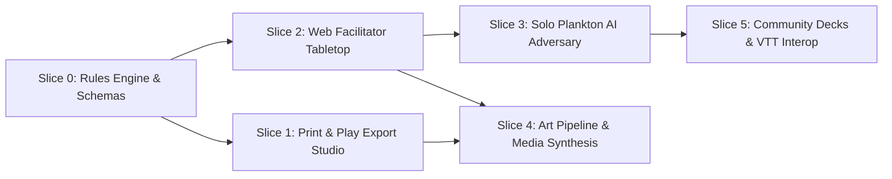

# Krabs Against Security: Vertical Slices & Delivery Roadmap

## 1. Overview & Phasing Strategy

To ensure rapid delivery, testable boundaries, and continuous verification, **Krabs Against Security (K.A.S.)** is divided into six progressive vertical slices (Slices 0 through 5).

Each slice delivers an end-to-end, testable capability spanning UI, logic, data, and documentation, ensuring that early milestones (such as physical card printing and headless game rules) provide immediate user value without waiting for downstream visual assets or multiplayer networking.

---

## 2. Slice Breakdown

### 2.1 Slice 0: Foundation, Rules Engine & Typed Data Models

- **Primary Goal**: Establish the core data schema, card catalog, and pure deterministic game simulation engine.
- **Scope & Deliverables**:
  - `card-schema-v1.json`: JSON Schema for all 6 card types, defining properties (id, title, deck, description, d20_threshold, attack_technique_id, modifiers, art_manifest_id).
  - `deck-schema-v1.json` & `scenario-schema-v1.json`: Schemas for pre-configured incident scenarios and deck collections.
  - Complete 80-card canonical registry in versioned JSON (`cards-v1.json`).
  - Pure TypeScript/JavaScript state machine (`KasGameEngine`):
    - Scenario generation (drawing 1 from each attack deck).
    - Defensive Procedure execution with d20 roll evaluation and modifier calculation.
    - Strike escalation tracking (1 to 10 strikes).
    - Inject trigger hooks.
    - NIST SP 800-61r2 phase progression tracking.
  - Deterministic headless test suite running automated simulation rounds.
- **Definition of Done (DoD)**:
  - 100% of schema definitions pass strict schema validators.
  - All 80 cards validated against schema with valid MITRE ATT&CK and NIST mappings.
  - Automated tests verify game victory, defeat, strike accumulation, and inject triggers across 1,000 deterministic seeded runs.

### 2.2 Slice 1: Print & Play Export Studio (The Core User Ask)

- **Primary Goal**: Empower users to immediately download, customize, and print physical card decks directly from the web interface.
- **Scope & Deliverables**:
  - Pure CSS/SVG Tier 0 procedural card template rendering all 80 cards with crisp typography, nautical iconography, and deck-specific borders.
  - Sheet Compositor Engine:
    - Standard 3x3 layout (9 cards per page) for **US Letter** ($8.5'' \times 11''$) and **ISO A4** ($210 \times 297\text{ mm}$).
    - Automatic horizontal column mirroring for back sheets ($[C_1, C_2, C_3] \leftrightarrow [C_3, C_2, C_1]$) ensuring perfect duplex long-edge alignment.
    - 2x3 Gutter-Fold craft layout for fold-and-glue construction.
  - Configurable Print Studio UI:
    - Paper format selector (Letter vs. A4).
    - Crop mark and cutting line toggles.
    - **Eco-Print Toggle**: High-contrast, background-free monochrome line art to save printer ink ($>75\%$ ink reduction).
    - Deck filter (print specific decks or full 80-card set).
  - Client-Side PDF Generation (`pdf-lib`): Generates pre-compiled, mathematically calibrated 300 DPI vector PDFs with zero browser print-dialog scaling distortion.
  - Single Card Zip Export: High-resolution PNGs ($750 \times 1050\text{ px}$) for custom sleeve printing.
- **Definition of Done (DoD)**:
  - Generated PDF prints front-to-back with $\le 1\text{ mm}$ drift on duplex hardware.
  - Eco-mode renders cleanly on monochrome laser printers.
  - Single card exports and full sheet exports validate against print dimension standards ($2.5'' \times 3.5''$ poker size).

### 2.3 Slice 2: Web Incident Tabletop & Facilitator App

- **Primary Goal**: Provide a browser-based digital tabletop for live incident response tabletop exercises (facilitator-led).
- **Scope & Deliverables**:
  - Responsive digital incident board:
    - Four face-down Breach Scenario slots (Initial Compromise, Pivot & Escalate, Persistence, C2 & Exfil).
    - Interactive card flip animations revealing attack telemetry upon successful d20 checks.
    - Visual Strike Counter (10 Krabby Patty strikes with visual doom clock progression).
    - Inject Tray with random drawer mechanics and active modifier badges.
  - Built-in Crustacean d20 Dice Roller:
    - 3D/CSS animated twenty-sided die with realistic roll physics.
    - Procedural audio cues (undersea bubble sonar, cash register ding on 20, sad foghorn on natural 1).
    - Automatic difficulty comparison displaying margin of success or failure.
  - Facilitator Control Panel:
    - Secret view toggle (allows the facilitator to view the breach cards privately while projecting the defender board on a shared screen or Zoom/Teams call).
    - Manual strike adjustment and custom incident note taking.
- **Definition of Done (DoD)**:
  - Facilitator can run a complete 30-minute tabletop incident exercise solely within the browser.
  - Facilitator secret view functions flawlessly without leaking scenario cards to the public projection view.
  - Touch-friendly on iPad/tablet and fully responsive on desktop displays.

### 2.4 Slice 3: Solo Incident Responder & Plankton Adversary Engine (AI Master)

- **Primary Goal**: Enable individual security practitioners or self-guided teams to play without requiring an experienced human facilitator.
- **Scope & Deliverables**:
  - **Plankton Adversary Engine**: Rule-based AI Incident Master simulating attacker counter-moves.
    - Dynamic attack progression: Plankton initiates automated lateral movement or exfiltration beacons every $N$ turns or failed rolls.
    - Intelligent Inject Dispatch: Selects contextual injects based on player actions (e.g., attempting Log Analysis triggers *Corrupted Syslog Daemon*).
  - Campaign Scenarios Pack (3 pre-packaged narrative campaigns):
    - *Scenario 1: The Sunday Lunch Rush Ransomware* (Beginner: POS ransomware outbreak).
    - *Scenario 2: The Scurvy Zero-Day* (Intermediate: Underwater SCADA fryer compromise).
    - *Scenario 3: The Deep-Sea Fiber Sabotage* (Advanced: State-sponsored trench espionage).
  - After-Action Review (AAR) Engine:
    - Computes NIST SP 800-61r2 incident score.
    - Calculates Mean Time to Detect (MTTD) and Mean Time to Contain (MTTC) in game turns.
    - Generates a humorous executive report signed by Mr. Krabs detailing financial damage, lost nickels, and regulatory fines.
- **Definition of Done (DoD)**:
  - Solo players can complete all three campaign scenarios from start to finish.
  - AAR report exports cleanly as Markdown or printable PDF.

### 2.5 Slice 4: Art Pipeline & Media Synthesis Integration

- **Primary Goal**: Execute the Tier 2 Art Deferral pipeline, synthesizing bespoke stylized illustrations for all 80 cards and integrating rich audio.
- **Scope & Deliverables**:
  - Execution of `art_manifest.json` batch generation using `art-router` / `image-generator` with FLUX.1-dev / SDXL pipelines.
  - Asset processing script converting outputs into optimized WebP ($800 \times 600\text{ px}$, $<80\text{ KB}$) and 300 DPI print-ready PNGs.
  - Dynamic web hydration: Cards automatically upgrade from Tier 0 vector glyphs to rich cartoon illustrations upon asset detection.
  - Full thematic audio soundpack: nautical ambient waves, underwater sonar pings, typing sounds, and retro alarm sirens.
- **Definition of Done (DoD)**:
  - All approved card illustrations render cleanly in both web tabletop and print-and-play PDF exports.
  - Total web bundle size overhead for images remains bounded with lazy-loading and WebP compression.

### 2.6 Slice 5: Community Decks & Virtual Tabletop (VTT) Interoperability

- **Primary Goal**: Open the platform to community expansions and third-party virtual tabletop environments.
- **Scope & Deliverables**:
  - In-browser Custom Card Creator:
    - Users write custom titles, d20 checks, MITRE tags, and flavor text.
    - Live card preview updating in real time.
  - Custom Deck Import/Export:
    - Export custom decks as portable JSON packages.
    - Direct import into the web tabletop or print studio.
  - Virtual Tabletop Exporters:
    - Tabletop Simulator (TTS) custom deck sheet composite ($10 \times 7$ grid layout).
    - Foundry VTT / Roll20 compatible JSON manifest.
- **Definition of Done (DoD)**:
  - Custom cards can be created, saved, exported to JSON, re-imported, and printed on standard 3x3 sheets.
  - Exported TTS deck sheet imports into Tabletop Simulator with correct face/back registration.
